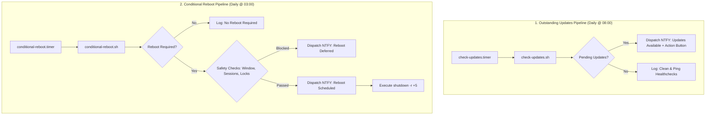

# Automated Security Patching & Reboot Orchestration
Design notes.
## Repository Layout
- `scripts/common-telemetry.sh`: Shared telemetry, NTFY dispatch, pending package queries, and failure handling routines.
- `scripts/check-updates.sh`: Dedicated pipeline to check for outstanding package updates and dispatch telemetry.
- `scripts/conditional-reboot.sh`: Core logic for checking reboot flags (`/run/reboot-required` / `needs-restarting -r`), user sessions, process locks, and scheduling reboots.
- `scripts/pending-updates-digest.sh`: Weekly Friday digest notifying of outstanding pending package updates.
- `scripts/apply-all-updates.sh`: Non-interactive full package upgrade runner with real-time telemetry.
- `scripts/remote-update-listener.sh`: Background listener daemon for two-way NTFY action button triggers.
- `scripts/apt-post-install-telemetry.sh`: Post-install execution hook for APT-based hosts.
- `scripts/generate-topic.sh`: Utility to generate unique, random NTFY topic names.
- `scripts/systemd-failure-notify.sh`: Systemd unit failure notification dispatcher.
- `units/`: Timer and service definitions for systemd reboot orchestration, update checking, digests, and remote listeners.
- `apt/apt.conf.d/99unattended-upgrades-local`: Debian/Ubuntu package manager local overrides.
- `dnf/99-dnf-automatic-local.conf`: RHEL/CentOS package manager local overrides.

---

## Pipeline Architecture & Decoupled Design

The system splits package management and reboot orchestration into two decoupled, independent pipelines to avoid mixing update notifications with reboot lifecycles:

### Key Architectural Separation

| Pipeline | Trigger / Schedule | Responsibility | Telemetry Output |
| :--- | :--- | :--- | :--- |
| **Outstanding Updates** | `check-updates.timer` (Daily @ 08:00) | Scans repositories for available packages waiting to be upgraded. | `📦 Updates Available` (includes interactive `[🚀 Apply All Updates]` button). |
| **Conditional Reboot** | `conditional-reboot.timer` (Daily @ 03:00) | Evaluates post-installation reboot flags (`/run/reboot-required` / `needs-restarting -r`). | `🔄 Reboot Scheduled` (when safe) or `ℹ️ Reboot Deferred` (when blocked). |

#### Why Decouple These Pipelines?
1. **Systems with Available Updates That Do Not Require a Reboot**: A host can have pending package upgrades without needing a restart. Decoupling ensures you are alerted to pending updates without false reboot warnings.
2. **Systems Needing a Reboot with No Further Updates**: A host that installed a kernel patch during an automated cycle may have zero outstanding updates but still needs a clean reboot.
3. **Collision Safety**: Keeping update scanning independent from reboot execution ensures maintenance windows are reserved strictly for safe reboot orchestration.

---

## Collision Prevention & Orchestration Safety

The pipeline guarantees that conditional reboots and package upgrades never collide:

1. **Process-Level Locks**:
   - `conditional-reboot.sh` inspects the system process table for active package managers (`apt`, `apt-get`, `dpkg`, `unattended-upgrade`, `dnf`, `yum`, `rpm`, `check-updates`, `apply-all-updates`).
   - If any upgrade or check is active, `conditional-reboot.sh` logs `Blocked process is active. Deferring reboot.` and defers without scheduling a restart.

2. **Filesystem Lock Inspection**:
   - `conditional-reboot.sh` checks package manager lock files (such as `/var/lib/dpkg/lock-frontend`, `/var/lib/apt/lists/lock`, `/var/run/dnf.pid`) using `fuser`. If a lock is held by an active process, reboot is deferred.

3. **Pre-Reboot Grace Delay**:
   - When all safety checks pass, `conditional-reboot.sh` dispatches a high-priority `🔄 Reboot Scheduled` notification and schedules `shutdown -r +5` (5-minute countdown).
   - This grace period gives operators time to cancel an automated reboot (`sudo shutdown -c`) if needed.

4. **Failure Flag Quarantine**:
   - If package installation encounters an error, the pipeline sets `/run/package-update.failed`.
   - `conditional-reboot.sh` refuses to restart the machine until the failure flag is resolved by a subsequent successful run.

---

## Notification Timing & NTFY Action Buttons

The pipeline supports remote action buttons via NTFY (e.g. `[🚀 Apply All Updates]`):

- **Delayed Execution**:
  If a notification arrives at 3:00 AM and you tap the action button at 3:00 PM (12 hours later), it works seamlessly. The NTFY action button issues a live HTTP request to your host's listener at the exact moment you tap it.
- **Real-Time State Evaluation**:
  When the action button triggers `apply-all-updates.sh`, the script evaluates package status live against current repositories.
- **Reboot Independence**:
  If a reboot occurs between receiving the notification and pressing the button, the system state remains clean (since `/run` flags reside on `tmpfs`). Tapping the button post-reboot simply queries the package manager; if updates were already applied, it safely reports that 0 packages need upgrading.
