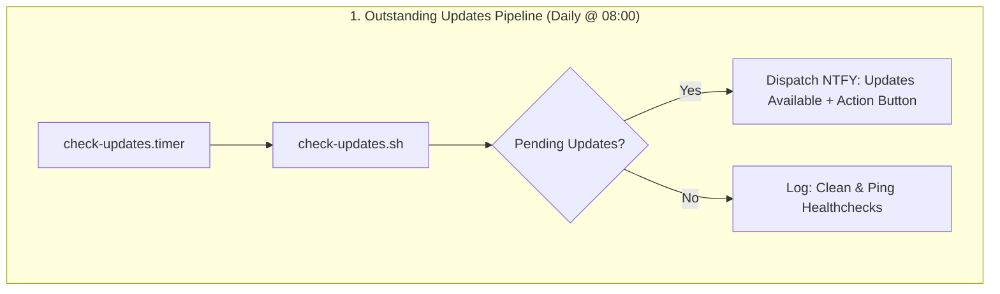
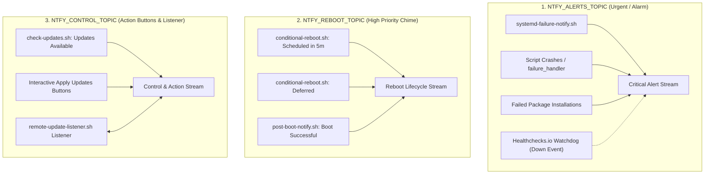
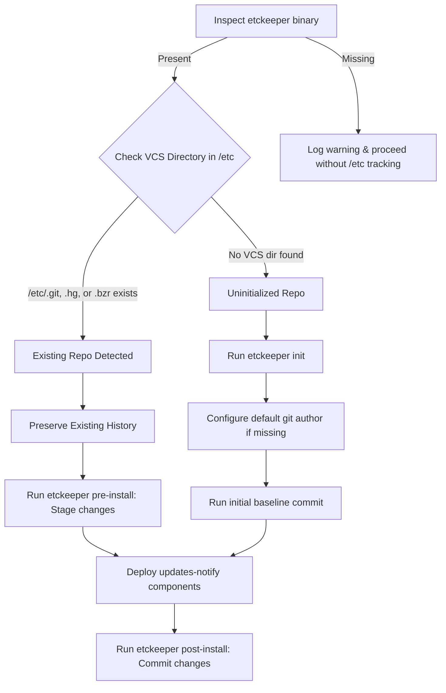

# Automated Security Patching & Reboot Orchestration
Design notes.
## Repository Layout
- `scripts/common-telemetry.sh`: Shared telemetry, NTFY dispatch, pending package queries, and failure handling routines.
- `scripts/check-updates.sh`: Dedicated pipeline to check for outstanding package updates and dispatch telemetry.
- `scripts/conditional-reboot.sh`: Core logic for checking reboot flags (`/run/reboot-required` / `needs-restarting -r`), user sessions, process locks, and scheduling reboots.
- `scripts/pending-updates-digest.sh`: Weekly Friday digest notifying of outstanding pending package updates.
- `scripts/apply-all-updates.sh`: Non-interactive full package upgrade runner with real-time telemetry.
- `scripts/remote-update-listener.sh`: Background listener daemon for two-way NTFY action button triggers.
- `scripts/apt-post-install-telemetry.sh`: Post-install execution hook for APT-based hosts.
- `scripts/post-boot-notify.sh`: Startup service confirming boot success, running kernel, and uptime.
- `scripts/generate-topic.sh`: Utility to generate unique, random NTFY topic names.
- `scripts/systemd-failure-notify.sh`: Systemd unit failure notification dispatcher.
- `units/`: Timer and service definitions for systemd reboot orchestration, update checking, digests, and remote listeners.
- `apt/apt.conf.d/99unattended-upgrades-local`: Debian/Ubuntu package manager local overrides.
- `dnf/99-dnf-automatic-local.conf`: RHEL/CentOS package manager local overrides.

---

## Pipeline Architecture & Decoupled Design

The system splits package management and reboot orchestration into two decoupled, independent pipelines to avoid mixing update notifications with reboot lifecycles:


```mermaid
    subgraph P2 ["2. Conditional Reboot Pipeline (Daily @ 03:00)"]
        F[conditional-reboot.timer] --> G[conditional-reboot.sh]
        G --> H{Reboot Required?}
        H -->|No| I[Log: No Reboot Required]
        H -->|Yes| J{Safety Checks: Window, Sessions, Locks}
        J -->|Blocked| K[Dispatch NTFY: Reboot Deferred]
        J -->|Passed| L[Dispatch NTFY: Reboot Scheduled]
        L --> M[Execute shutdown -r +5]
    end
```

### Key Architectural Separation

| Pipeline | Trigger / Schedule | Responsibility | Telemetry Output |
| :--- | :--- | :--- | :--- |
| **Outstanding Updates** | `check-updates.timer` (Daily @ 08:00) | Scans repositories for available packages waiting to be upgraded. | `📦 Updates Available` (includes interactive `[🚀 Apply All Updates]` button). |
| **Conditional Reboot** | `conditional-reboot.timer` (Daily @ 03:00) | Evaluates post-installation reboot flags (`/run/reboot-required` / `needs-restarting -r`). | `🔄 Reboot Scheduled` (when safe) or `ℹ️ Reboot Deferred` (when blocked). |

#### Why Decouple These Pipelines?
1. **Systems with Available Updates That Do Not Require a Reboot**: A host can have pending package upgrades without needing a restart. Decoupling ensures you are alerted to pending updates without false reboot warnings.
2. **Systems Needing a Reboot with No Further Updates**: A host that installed a kernel patch during an automated cycle may have zero outstanding updates but still needs a clean reboot.
3. **Collision Safety**: Keeping update scanning independent from reboot execution ensures maintenance windows are reserved strictly for safe reboot orchestration.

---

## 3-Topic Fleet Architecture & Watchdog Routing

To avoid alert fatigue and enable tailored sound, vibration, and priority policies across mobile and desktop devices, the pipeline routes notifications through three distinct functional channels:



### Channel Routing & Purpose

| Topic Parameter | Intended Purpose | Urgency Level | Special Integration Notes |
| :--- | :--- | :--- | :--- |
| **`NTFY_ALERTS_TOPIC`** | Critical service crashes, update failures, pipeline errors. | **Max / Urgent** | **Designated Target for Healthchecks.io Watchdog**: Configure your Healthchecks.io check integration to forward missing-heartbeat / down notifications directly into this topic. |
| **`NTFY_REBOOT_TOPIC`** | Scheduled reboots (5m countdown), deferral notices, and post-boot startup confirmations. | **High** | Alerts you when a reboot is pending or confirms when a node has successfully returned online. |
| **`NTFY_CONTROL_TOPIC`** | Outstanding update digests, interactive `[🚀 Apply Updates]` buttons, and the listener daemon. | **Default** | Houses remote action triggers; secured via HMAC-SHA256 signatures and publisher ACLs. |

### Channel Allocation Map

| Channel | Target Topic | Associated Messages & Triggers | Priority | Source Script / Service |
| :--- | :--- | :--- | :--- | :--- |
| **Alerts** | `NTFY_ALERTS_TOPIC` | • `🚨 Systemd Execution Failure`<br>• `❌ Updates Failed`<br>• `⚠️ Reboot Aborted`<br>• `🚨 Pipeline Failure`<br>• Healthchecks.io watchdog down/timeout alerts | `urgent` | • `systemd-failure-notify.sh`<br>• `apply-all-updates.sh`<br>• `conditional-reboot.sh`<br>• `common-telemetry.sh` (`failure_handler`)<br>• Healthchecks.io integration |
| **Reboot** | `NTFY_REBOOT_TOPIC` | • `🔄 Reboot Scheduled` (5m countdown)<br>• `ℹ️ Reboot Deferred` (active user sessions, outside window, process/file locks)<br>• `✅ Boot Successful` (system back online) | `high` / `default` | • `conditional-reboot.sh`<br>• `post-boot-notify.sh` |
| **Control** | `NTFY_CONTROL_TOPIC` | • `📦 Updates Available`<br>• `📦 Weekly Updates Digest`<br>• `⏳ Updates In Progress`<br>• `✅ Updates Completed`<br>• `[🚀 Apply Updates]` action button POST target<br>• `remote-update-listener.sh` subscription stream | `default` (min priority on button click) | • `check-updates.sh`<br>• `pending-updates-digest.sh`<br>• `apply-all-updates.sh`<br>• `common-telemetry.sh`<br>• `remote-update-listener.sh` |

### Fleet Multi-Host Differentiation
On shared topics spanning multiple machines:
- **Title Prefixing**: All telemetry messages automatically prepend `[<hostname>]` (e.g. `[pond] 🔄 Reboot Scheduled`).
- **Targeted Action Payloads**: Remote action buttons embed target host IDs (`apply_updates:<hostname>:...`) so other nodes sharing the topic ignore non-targeted commands.

---

## Collision Prevention & Orchestration Safety

The pipeline guarantees that conditional reboots and package upgrades never collide:

1. **Process-Level Locks**:
   - `conditional-reboot.sh` inspects the system process table for active package managers (`apt`, `apt-get`, `dpkg`, `unattended-upgrade`, `dnf`, `yum`, `rpm`, `check-updates`, `apply-all-updates`).
   - If any upgrade or check is active, `conditional-reboot.sh` logs `Blocked process is active. Deferring reboot.` and defers without scheduling a restart.

2. **Filesystem Lock Inspection**:
   - `conditional-reboot.sh` checks package manager lock files (such as `/var/lib/dpkg/lock-frontend` on Debian/Ubuntu, `/run/lock/libdnf5` on RHEL 10, `/var/lib/dnf/rpmdb_lock.pid` and `/var/cache/dnf/*_lock.pid` on RHEL 9) using `fuser`. If a lock is held by an active process, reboot is deferred.

3. **Pre-Reboot Grace Delay**:
   - When all safety checks pass, `conditional-reboot.sh` dispatches a high-priority `🔄 Reboot Scheduled` notification and schedules `shutdown -r +5` (5-minute countdown).
   - This grace period gives operators time to cancel an automated reboot (`sudo shutdown -c`) if needed.

4. **Failure Flag Quarantine**:
   - If package installation encounters an error, the pipeline sets `/run/package-update.failed`.
   - `conditional-reboot.sh` refuses to restart the machine until the failure flag is resolved by a subsequent successful run.

---

## Notification Timing & NTFY Action Buttons

The pipeline supports remote action buttons via NTFY (e.g. `[🚀 Apply All Updates]`):

- **Delayed Execution**:
  If a notification arrives at 3:00 AM and you tap the action button at 3:00 PM (12 hours later), it works seamlessly. The NTFY action button issues a live HTTP request to your host's listener at the exact moment you tap it.
- **Real-Time State Evaluation**:
  When the action button triggers `apply-all-updates.sh`, the script evaluates package status live against current repositories.
- **Reboot Independence**:
  If a reboot occurs between receiving the notification and pressing the button, the system state remains clean (since `/run` flags reside on `tmpfs`). Tapping the button post-reboot simply queries the package manager; if updates were already applied, it safely reports that 0 packages need upgrading.
- **Publisher Verification (ACL)**:
  `remote-update-listener.sh` connects to the structured `/json` stream instead of `/raw`. This filters out keepalive/handshake traffic and enables strict sender authentication via `NTFY_VALID_USER`. If configured, any command not published by the authorized account is rejected with a security log warning.

---

## Automated Dependency Provisioning & Safe etckeeper Detection

### 1. Automated Cross-Platform Dependency Provisioning

To enable zero-touch bootstrapping across heterogeneous fleets, `deploy.sh` automates the dependency and repository resolution process:

- **RHEL Ecosystem (RHEL 9+, CentOS Stream, Rocky Linux, AlmaLinux)**:
  - **Dynamic Version Detection**: Extracts the active major version at runtime from `/etc/os-release` (`VERSION_ID`), with `rpm -E %rhel` fallback, cleanly validating an integer (`9`, `10`, etc.) across bare-metal and virtual Enterprise Linux hosts.
  - **CodeReady Linux Builder (CRB)**: Automatically activates the CRB / PowerTools repository, which is required to satisfy upstream package dependencies for EPEL tools:
    - On registered RHEL nodes: `subscription-manager repos --enable codeready-builder-for-rhel-${rhel_ver}-$(arch)-rpms`
    - On RHEL clones / standard DNF systems: `crb enable` or `dnf config-manager --set-enabled crb`
  - **EPEL Provisioning**: Automatically installs the Extra Packages for Enterprise Linux (EPEL) configuration package if not already registered, ensuring `etckeeper` is installable.
  - **Core Tools**: Resolves and installs missing core requirements (`dnf-utils` or `dnf-plugins-core`, `dnf-automatic`, `etckeeper`, `git`, `openssl`, `curl`).
- **Debian / Ubuntu Ecosystem (Ubuntu 22.04+, Debian 12+)**:
  - Automatically updates package indexes and installs missing dependencies (`unattended-upgrades`, `etckeeper`, `git`, `openssl`, `curl`) using `DEBIAN_FRONTEND=noninteractive`.

---

### 2. Safe `etckeeper` Repository Detection & VCS Preservation

Managing `/etc` in version control is critical for infrastructure stability, but automated installers often risk re-initializing and overwriting existing repositories. The deployment pipeline enforces strict VCS safety checks:



#### Safety Guarantees:
1. **Zero-Destruction Guarantee**: `deploy.sh` checks for the presence of `/etc/.git`, `/etc/.hg`, or `/etc/.bzr`. If an existing VCS repository is found, `etckeeper init` is **never** executed, preserving all past commit history, remotes, branches, and custom hooks.
2. **Pre-Deployment Staging**: If an initialized repository is detected, `deploy.sh` calls `etckeeper pre-install` prior to writing any files, ensuring that any uncommitted local system modifications are staged.
3. **Safe First-Time Initialization**: If `etckeeper` was newly installed or never initialized, the script initializes the repository and creates an initial baseline commit before applying pipeline changes.
4. **Post-Deployment Audit Commit**: Once deployment completes successfully, `etckeeper post-install` commits the exact file additions and permission changes made by `deploy.sh`.

---

### 3. Idempotent Configuration Merging & Default Reference Annotations

To keep production nodes synchronized with upstream configuration template improvements without clobbering host-specific values:
- **Site-Specific Group Staging (`site-conf/<system-group-name>/`)**: Host and group configurations are staged locally in `site-conf/<group>/99-local.conf` and excluded from version control via `.gitignore`.
- **Automated Configuration Generator (`generate-topic.sh`)**: Generates pre-populated site configurations containing two separate, independent cryptographic items: a high-entropy NTFY topic name (for public endpoints) and an isolated 256-bit `FLEET_SECRET` (for private HMAC-SHA256 payload signing).
- **Group-Targeted Deployments (`deploy.sh <system-group-name>`)**: Extracts site configuration from `site-conf/<group>/` and merges it into the operational `/etc/conditional-reboot.conf.d/99-local.conf`.
- **Reference Default Commenting**: When a setting exists in the template (`99-local.conf.example`), `deploy.sh` ensures that exactly one `# Default: <template_setting>` line is placed directly above the node's local active assignment, separated by clean blank-line spacing.
- **Upstream Default Sync**: If an upstream default changes in a future release, subsequent deployments update the `# Default:` comment to reflect the new reference value while strictly leaving the host's custom setting below it untouched.
- **New & Optional Settings**: Any newly introduced parameters (including commented optional parameters like `NTFY_CMD_TOPIC` or `NTFY_VALID_USER`) are automatically appended with their accompanying documentation blocks.
- **Pre-Modification Backups**: Creates timestamped backups (`.YYYYMMDD-HHMMSS.bak`, retaining up to 3) before making any modifications.
