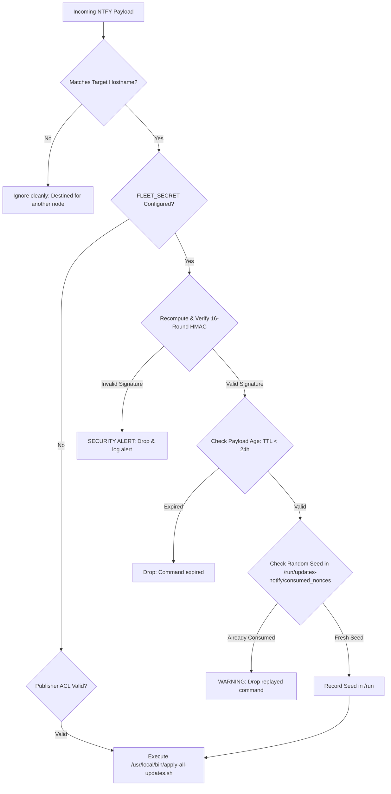

# Security Architecture & Hardening Guide

This document details the threat model, cryptographic mechanisms, and operational controls implemented across the `updates-notify` pipeline to secure remote notifications, action triggers, and automated maintenance workflows—even when operating over shared or public notification infrastructure.

---

## 1. Threat Model & Risk Analysis

In an automated maintenance pipeline with remote update capabilities, the primary security risks include:

| Threat Vector | Description | Mitigation in `updates-notify` |
| :--- | :--- | :--- |
| **Unauthorized Remote Execution** | An outside attacker discovers a public topic and publishes malicious upgrade commands. | Cryptographic HMAC-SHA256 signatures, Publisher ACLs, and strict command whitelisting. |
| **Command Replay Attacks** | An eavesdropper captures an action button payload and re-publishes it later. | Strict 24-hour TTL expiration window and one-time consumed nonce tracking. |
| **Accidental Multi-Triggering** | An operator taps an action button multiple times in rapid succession. | Native `clear=true` notification dismissal and single-execution nonce guards. |
| **Cross-Host Collision** | An action button intended for Node A accidentally triggers upgrades on Node B. | Explicit host-targeted payloads (`apply_updates:<hostname>:...`). |
| **Network Probing / Ingress Exploits** | Attackers scan the node for open ports or exposed webhooks. | Outbound-only, pull-based architecture with zero open listening ports. |
| **Package Tampering** | An attacker attempts to inject unauthorized software during an upgrade. | Native GPG repository signature validation enforced by APT and DNF. |
| **Local Credential Theft** | Non-privileged local users inspect tokens and keys. | Strict filesystem permissions (`0700` directory, `0600` config). |

---

## 2. Cryptographic HMAC-SHA256 Action Buttons

When using public NTFY servers or shared topics without paid server-side write restrictions, the pipeline provides end-to-end cryptographic payload authentication via `FLEET_SECRET`.

To prevent attacks relying on predictable timestamps, each action button generates a **cryptographically random seed (nonce)** and runs the signature through **sequential HMAC-SHA256 stretching rounds** (similar to the Key Derivation Function (KDF) rounds used in `ssh-keygen -a`).

### Payload Format
Action buttons generate payloads adhering to the following structure:
```text
apply_updates:<target_hostname>:<unix_timestamp>:<random_seed>:<stretched_hmac_sha256>
```

- **`<target_hostname>`**: The specific node targeted by the action button (e.g. `lake`).
- **`<unix_timestamp>`**: Time of creation, enforcing the 24-hour TTL expiration window.
- **`<random_seed>`**: 16 cryptographically random hexadecimal characters from `/dev/urandom`. Prevents hash predictability and rainbow-table attacks.
- **`<stretched_hmac_sha256>`**: 64-character hex signature computed through 16 sequential HMAC rounds.

### Cryptographic Multi-Round Algorithm
The shared library function `compute_payload_hmac()` implements iterative round stretching:
```bash
compute_payload_hmac() {
    local secret="$1" hostname="$2" timestamp="$3" seed="$4" rounds="${5:-16}"

    local data="${hostname}:${timestamp}:${seed}"
    local digest
    digest="$(echo -n "${data}" | openssl dgst -sha256 -hmac "${secret}" | awk '{print $2}')"

    # Multi-round stretching (prevents fast offline brute-force attacks)
    for (( r=2; r<=rounds; r++ )); do
        digest="$(echo -n "${digest}:${seed}:${r}" | openssl dgst -sha256 -hmac "${secret}" | awk '{print $2}')"
    done

    echo "${digest}"
}
```

### Verification Pipeline
When `remote-update-listener.sh` receives a message from the stream, it executes the following verification stages:



1. **Host-Target Verification**: The payload must explicitly match `${MY_HOSTNAME}`. Messages intended for other hosts are silently ignored.
2. **Signature Authenticity**: The listener recomputes the 16-round HMAC-SHA256 hash using the local `FLEET_SECRET`. If the hash does not match identically, the command is dropped and logged as a security alert.
3. **Time-To-Live (TTL) Enforcement**: The timestamp embedded in the payload is compared against the current host time. If the payload is older than 24 hours (`86400s`) or skewed more than 5 minutes into the future, it is dropped as expired.
4. **Anti-Replay / Seed Tracking**: Valid payloads are recorded by their unique `<seed>:<signature>` in `/run/updates-notify/consumed_nonces`. Any repeated reception of an identical seed is blocked.

---

## 3. Notification Dismissal (`clear=true`)

To prevent accidental double-execution when an operator taps an action button:
- All interactive HTTP action buttons dispatched by `check-updates.sh` include **`clear=true`**.
- When tapped on an Android, iOS, or desktop client:
  1. The client issues the signed HTTP POST to the command topic.
  2. The notification is immediately dismissed and cleared from the notification center and lock screen.
  3. The prompt is removed, preventing duplicate taps.

---

## 4. Publisher Identity Verification (ACL)

`remote-update-listener.sh` connects to the structured NTFY JSON event stream (`/json`) rather than raw text:
- In the JSON stream, NTFY supplies the authenticated account name in the `"username"` field.
- If `NTFY_VALID_USER` is configured in `/etc/conditional-reboot.conf.d/99-local.conf`, the listener drops any message published by anonymous users or unapproved accounts:
  ```bash
  if [[ -n "${EXPECTED_USER}" && "${sender_user}" != "${EXPECTED_USER}" ]]; then
      logger -t remote-listener "WARNING: Blocked execution attempt from unauthorized publisher '${sender_user:-anonymous}'"
      continue
  fi
  ```

---

## 5. Zero Remote Code Execution (RCE) Guarantee

The remote listener is strictly bounded against code injection:
- The incoming payload is **never** evaluated with `eval`, passed to `bash -c`, or parsed inside dynamic subshells.
- The payload is parsed using anchored regular expressions:
  ```bash
  ^apply_updates:([^:]+):([0-9]+):([a-fA-F0-9]+)$
  ```
- The execution path is hardcoded directly to the local root executable:
  ```text
  /usr/local/bin/apply-all-updates.sh
  ```
- No arbitrary commands, parameters, or external arguments can be passed into the execution environment.

---

## 6. GPG Cryptographic Package Verification

All updates triggered through the pipeline execute through native package managers:
- **Debian / Ubuntu**: `apt-get` verifies release signatures against trusted keyrings in `/etc/apt/trusted.gpg.d/` and `/usr/share/keyrings/`.
- **RHEL / CentOS / Rocky / Alma**: `dnf` verifies RPM header signatures against imported GPG keys (`/etc/pki/rpm-gpg/`).
- Package updates cannot be forged or redirected to untrusted packages, ensuring supply-chain integrity.

---

## 7. Local Filesystem Isolation

All sensitive configurations containing tokens, webhook UUIDs, and shared secrets reside in:
```text
/etc/conditional-reboot.conf.d/99-local.conf
```
Permissions are enforced at deployment:
- **Directory**: `chmod 0700 root:root /etc/conditional-reboot.conf.d`
- **Configuration File**: `chmod 0600 root:root /etc/conditional-reboot.conf.d/99-local.conf`
- **Backup Files**: All automated `.YYYYMMDD-HHMMSS.bak` backup files retain `chmod 0600 root:root`.

Non-root local users and unprivileged service accounts cannot read or traverse these paths.

---

## 8. Configuring Cryptographic Secrets

To enable HMAC-SHA256 signature verification on your fleet:

1. **Generate a 256-bit random secret**:
   ```bash
   openssl rand -hex 32
   ```

2. **Add to `/etc/conditional-reboot.conf.d/99-local.conf`**:
   ```bash
   # Shared secret for HMAC-SHA256 signing of remote action buttons
   FLEET_SECRET="d8e52a9f4c3b018e6d2a7f5c9e1b4a8d3f6c2e0a1b5c9d4e8f2a7b3c1d5e9f0a"
   ```

3. **Verify restrictive permissions**:
   ```bash
   sudo chmod 0600 /etc/conditional-reboot.conf.d/99-local.conf
   ```
