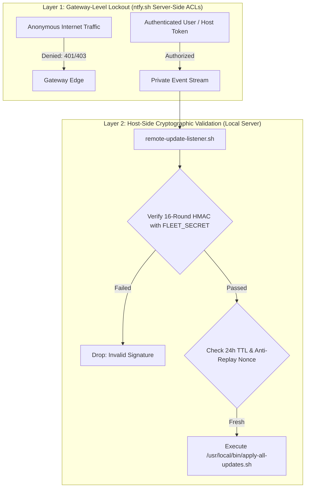
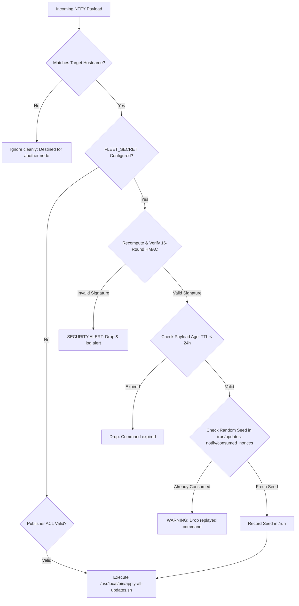

# Security Architecture & Hardening Guide

This document details the threat model, cryptographic mechanisms, and operational controls implemented across the `updates-notify` pipeline to secure remote notifications, action triggers, and automated maintenance workflows—even when operating over shared or public notification infrastructure.

---

## 1. Threat Model & Risk Analysis

In an automated maintenance pipeline with remote update capabilities, the primary security risks include:

| Threat Vector | Description | Mitigation in `updates-notify` |
| :--- | :--- | :--- |
| **Unauthorized Remote Execution** | An outside attacker discovers a public topic and publishes malicious upgrade commands. | Cryptographic HMAC-SHA256 signatures, Publisher ACLs, and strict command whitelisting. |
| **Command Replay Attacks** | An eavesdropper captures an action button payload and re-publishes it later. | Strict 24-hour TTL expiration window and one-time consumed nonce tracking. |
| **Accidental Multi-Triggering** | An operator taps an action button multiple times in rapid succession. | Native `clear=true` notification dismissal and single-execution nonce guards. |
| **Cross-Host Collision** | An action button intended for Node A accidentally triggers upgrades on Node B. | Explicit host-targeted payloads (`apply_updates:<hostname>:...`). |
| **Network Probing / Ingress Exploits** | Attackers scan the node for open ports or exposed webhooks. | Outbound-only, pull-based architecture with zero open listening ports. |
| **Package Tampering** | An attacker attempts to inject unauthorized software during an upgrade. | Native GPG repository signature validation enforced by APT and DNF. |
| **Local Credential Theft** | Non-privileged local users inspect tokens and keys. | Strict filesystem permissions (`0700` directory, `0600` config). |

---

## 2. Server-Side ACLs & Two-Tier Defense-in-Depth

Restricting the NTFY control topic on the server side (Read/Write access granted exclusively to your account token, with anonymous access completely denied) elevates the pipeline to an enterprise-grade **dual-tier defense-in-depth architecture**.



### Why Both Layers Matter (Independent Failure Domains)

Combining server-side ACLs with host-side HMAC signatures creates two completely independent security perimeters:

| Security Dimension | Gateway ACL Only | Host HMAC Only | Combined Defense-in-Depth |
| :--- | :--- | :--- | :--- |
| **Stream Eavesdropping** | ✅ Blocked (Gateway rejects unauthenticated readers). | ❌ Visible (Attackers can monitor message timing and hostnames). | ✅ **Completely Blind**: Unauthorized readers receive `403 Forbidden` at the edge. |
| **Traffic Spam / DoS** | ✅ Blocked (Unauthenticated posts are dropped at the edge). | ❌ Scanner spam reaches server and fills syslog with rejected HMAC warnings. | ✅ **Clean Logs**: Only valid traffic reaches the host listener. |
| **Credential Breach: Leaked NTFY Token** | ❌ Vulnerable (Attacker has write access). | ✅ Protected (Attacker still lacks `FLEET_SECRET`). | ✅ **Protected**: An attacker with your NTFY token cannot execute updates without the private `FLEET_SECRET`. |
| **Credential Breach: Leaked `FLEET_SECRET`** | ✅ Protected (Attacker lacks NTFY token). | ❌ Vulnerable (Attacker can sign payloads). | ✅ **Protected**: An attacker with your `FLEET_SECRET` is blocked from publishing at the NTFY gateway. |

To compromise a node, an adversary would have to breach **both** your private NTFY cloud subscription account and the server's local root filesystem (`0600 root:root`) simultaneously.

---

## 3. Cryptographic HMAC-SHA256 Action Buttons

When using public NTFY servers or shared topics without paid server-side write restrictions, the pipeline provides end-to-end cryptographic payload authentication via `FLEET_SECRET`.

### Complete Separation of Public Topics and Private Secrets
The public NTFY topic name and the `FLEET_SECRET` are generated as **two completely independent random values**:
- **`NTFY_TOPIC`** (`pw-<group>-updates-<16-hex>`): A public, high-entropy routing endpoint visible in URLs.
- **`FLEET_SECRET`** (256-bit hex): A confidential, host-isolated signing key locked down (`0600 root:root`) in `/etc/conditional-reboot.conf.d/99-local.conf`.

The topic name is **never derived from, combined with, or related to** the secret. Even if an attacker monitors or intercepts the topic URL, zero knowledge of the signing key is leaked.

To prevent attacks relying on predictable timestamps, each action button generates a **cryptographically random seed (nonce)** and runs the signature through **sequential HMAC-SHA256 stretching rounds** (similar to the Key Derivation Function (KDF) rounds used in `ssh-keygen -a`).

### Payload Format
Action buttons generate payloads adhering to the following structure:
```text
apply_updates:<target_hostname>:<unix_timestamp>:<random_seed>:<stretched_hmac_sha256>
```

- **`<target_hostname>`**: The specific node targeted by the action button (e.g. `lake`).
- **`<unix_timestamp>`**: Time of creation, enforcing the 24-hour TTL expiration window.
- **`<random_seed>`**: 16 cryptographically random hexadecimal characters from `/dev/urandom`. Prevents hash predictability and rainbow-table attacks.
- **`<stretched_hmac_sha256>`**: 64-character hex signature computed through 16 sequential HMAC rounds.

### Cryptographic Multi-Round Algorithm
The shared library function `compute_payload_hmac()` implements iterative round stretching:
```bash
compute_payload_hmac() {
    local secret="$1" hostname="$2" timestamp="$3" seed="$4" rounds="${5:-16}"

    local data="${hostname}:${timestamp}:${seed}"
    local digest
    digest="$(echo -n "${data}" | openssl dgst -sha256 -hmac "${secret}" | awk '{print $2}')"

    # Multi-round stretching (prevents fast offline brute-force attacks)
    for (( r=2; r<=rounds; r++ )); do
        digest="$(echo -n "${digest}:${seed}:${r}" | openssl dgst -sha256 -hmac "${secret}" | awk '{print $2}')"
    done

    echo "${digest}"
}
```

### Verification Pipeline
When `remote-update-listener.sh` receives a message from the stream, it executes the following verification stages:



1. **Host-Target Verification**: The payload must explicitly match `${MY_HOSTNAME}`. Messages intended for other hosts are silently ignored.
2. **Signature Authenticity**: The listener recomputes the 16-round HMAC-SHA256 hash using the local `FLEET_SECRET`. If the hash does not match identically, the command is dropped and logged as a security alert.
3. **Time-To-Live (TTL) Enforcement**: The timestamp embedded in the payload is compared against the current host time. If the payload is older than 24 hours (`86400s`) or skewed more than 5 minutes into the future, it is dropped as expired.
4. **Anti-Replay / Seed Tracking**: Valid payloads are recorded by their unique `<seed>:<signature>` in `/run/updates-notify/consumed_nonces`. Any repeated reception of an identical seed is blocked.

---

## 4. Visibility of Action Payloads on the Control Topic: Why It Is Safe

When an operator taps **`[🚀 Apply Updates]`**, a message adhering to the following format appears in the `NTFY_CONTROL_TOPIC` feed:
```text
apply_updates:pond:1792584058:bed7ec8f5aacb84e:5d3b52569474fdf20d02e430faf2bc0aea5a38bf55fdc18537a3efd9f1a84784
```

### Why Does This Message Appear?
Action buttons operate via standard HTTP POST callbacks. Tapping the button causes your mobile or desktop client to send an HTTP POST to the control topic URL. NTFY publishes this message to all subscribers:
- The managed host (`pond`) receives the message via its background listener and executes the update runner.
- Your notification client also receives the message because it is subscribed to the topic.

### Why Is This NOT a Security Vulnerability?
Even if an unauthorized third party monitors the public topic and intercepts this payload, it cannot be weaponized against your fleet:

1. **One-Way Cryptographic Irreversibility**:
   HMAC-SHA256 is a one-way hash function. It is mathematically impossible to deduce or reverse-engineer `FLEET_SECRET` from the signature string.
2. **Single-Use Nonce / Anti-Replay Defense**:
   When the target node (`pond`) accepts the payload, it writes the random seed (`bed7ec8f5aacb84e`) into `/run/updates-notify/consumed_nonces`. If an eavesdropper copies the exact string and posts it again, the node drops it immediately:
   ```text
   WARNING: Blocked replayed update command (seed bed7ec8f5aacb84e already consumed).
   ```
3. **Strict 24-Hour Expiration (TTL)**:
   The embedded Unix timestamp (`1792584058`) enforces a 24-hour expiration window. Any payload older than 24 hours is rejected automatically.
4. **Tamper-Proof Host Targeting**:
   An attacker cannot change the target host (e.g. changing `pond` to `lake`) or update the timestamp to bypass the TTL. Altering a single byte invalidates the 16-round HMAC signature. Without `FLEET_SECRET`, generating a valid replacement signature is impossible.
5. **No Arbitrary Remote Code Execution**:
   The listener never evaluates or executes the message content. It strictly validates the payload structure and only invokes `/usr/local/bin/apply-all-updates.sh`.

### Client Echo Suppression (`headers.Priority=1` & `clear=true`)
To prevent the control payload from producing noise or waking your phone:
- **`headers.Priority=1`**: Configured in the action button so the incoming POST registers as minimum priority (`min`), suppressing notification popups, sounds, and vibrations on subscribed devices.
- **`clear=true`**: Automatically dismisses and clears the original notification prompt from your device's notification tray the instant the button is tapped.

---

## 5. Publisher Identity Verification (ACL)

`remote-update-listener.sh` connects to the structured NTFY JSON event stream (`/json`) rather than raw text:
- In the JSON stream, NTFY supplies the authenticated account name in the `"username"` field.
- If `NTFY_VALID_USER` is configured in `/etc/conditional-reboot.conf.d/99-local.conf`, the listener drops any message published by anonymous users or unapproved accounts:
  ```bash
  if [[ -n "${EXPECTED_USER}" && "${sender_user}" != "${EXPECTED_USER}" ]]; then
      logger -t remote-listener "WARNING: Blocked execution attempt from unauthorized publisher '${sender_user:-anonymous}'"
      continue
  fi
  ```

---

## 6. Zero Remote Code Execution (RCE) Guarantee

The remote listener is strictly bounded against code injection:
- The incoming payload is **never** evaluated with `eval`, passed to `bash -c`, or parsed inside dynamic subshells.
- The payload is parsed using anchored regular expressions:
  ```bash
  ^apply_updates:([^:]+):([0-9]+):([a-fA-F0-9]+)$
  ```
- The execution path is hardcoded directly to the local root executable:
  ```text
  /usr/local/bin/apply-all-updates.sh
  ```
- No arbitrary commands, parameters, or external arguments can be passed into the execution environment.

---

## 7. GPG Cryptographic Package Verification

All updates triggered through the pipeline execute through native package managers:
- **Debian / Ubuntu**: `apt-get` verifies release signatures against trusted keyrings in `/etc/apt/trusted.gpg.d/` and `/usr/share/keyrings/`.
- **RHEL / CentOS / Rocky / Alma**: `dnf` verifies RPM header signatures against imported GPG keys (`/etc/pki/rpm-gpg/`).
- Package updates cannot be forged or redirected to untrusted packages, ensuring supply-chain integrity.

---

## 8. Local Filesystem Isolation

All sensitive configurations containing tokens, webhook UUIDs, and shared secrets reside in:
```text
/etc/conditional-reboot.conf.d/99-local.conf
```
Permissions are enforced at deployment:
- **Directory**: `chmod 0700 root:root /etc/conditional-reboot.conf.d`
- **Configuration File**: `chmod 0600 root:root /etc/conditional-reboot.conf.d/99-local.conf`
- **Backup Files**: All automated `.YYYYMMDD-HHMMSS.bak` backup files retain `chmod 0600 root:root`.

Non-root local users and unprivileged service accounts cannot read or traverse these paths.

---

## 9. Configuring Cryptographic Secrets

To enable HMAC-SHA256 signature verification on your fleet:

1. **Generate a site configuration with a unique secret**:
   ```bash
   ./scripts/generate-topic.sh homelab eric
   ```
   This generates `site-conf/homelab/99-local.conf` with a cryptographically random 256-bit `FLEET_SECRET` and timestamp `FLEET_SECRET_CREATED_DATE`.

2. **Deploy to target hosts**:
   ```bash
   sudo ./deploy.sh homelab
   ```

---

## 10. Secret Rotation Lifecycle (Routine vs. Emergency)

Secrets should be rotated periodically (e.g., every 6–12 months) or immediately upon suspicion of a leak. `generate-topic.sh` provides built-in automation for both scenarios:

### A. Routine Rotation (`--rotate-secret`)
For scheduled rotations without disrupting active mobile notifications:
```bash
./scripts/generate-topic.sh --rotate-secret homelab
```

- **Dual-Key Staging**: Shifts the current key to `FLEET_SECRET_PREVIOUS` and sets a new `FLEET_SECRET`.
- **Self-Revoking Grace Window**: The listener accepts buttons signed by `FLEET_SECRET_PREVIOUS` only while:
  $$\text{Current Time} < \text{FLEET\_SECRET\_CREATED\_DATE} + 24\text{ hours}$$
  After 24 hours, the previous secret automatically expires in code—no secondary cleanup required.
- **Service Restart**: The tool prompts to restart `remote-update-listener.service`.

### B. Emergency Rotation (`--rotate-emergency`)
For immediate containment of a compromised credential or token:
```bash
./scripts/generate-topic.sh --rotate-emergency homelab
```

- **Zero Grace Window**: Immediately clears `FLEET_SECRET_PREVIOUS` and generates a fresh `FLEET_SECRET`.
- **Replay Cache Flush**: Clears `/run/updates-notify/consumed_nonces`.
- **Immediate Lockout**: Prompts to immediately restart `remote-update-listener.service`. Any subsequent attempt to trigger an update using the old secret fails instantly with a `SECURITY ALERT`.

---

## 11. Watchdog Integration (Healthchecks.io)

Each managed node reports periodic heartbeats to its own private Healthchecks.io check URL (`HC_PING_URL`).

- **Alert Routing Target**: In your Healthchecks.io dashboard, configure the NTFY alert integration to target your **`NTFY_ALERTS_TOPIC`** using your Bearer authentication token.
- **Dead Man's Switch**: If a node experiences a hard crash, power cut, or complete network disconnection, it cannot send an alert itself. Healthchecks detects the missing heartbeat and sends a down event directly to `NTFY_ALERTS_TOPIC`.
- **Alert Quietness**: Because Healthchecks only alerts on state transitions (`UP` $\rightarrow$ `DOWN` and `DOWN` $\rightarrow$ `UP`), it alerts you immediately during an outage without spamming the alerts channel.
